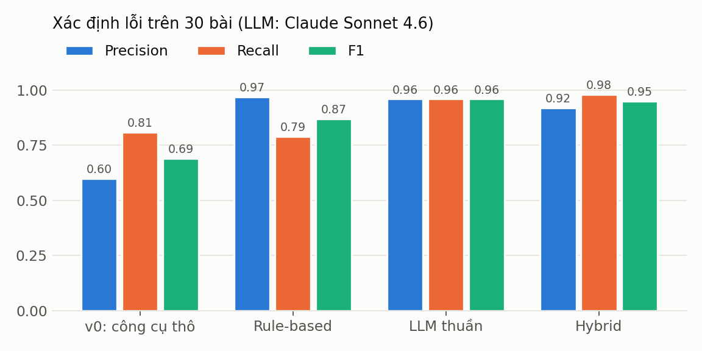
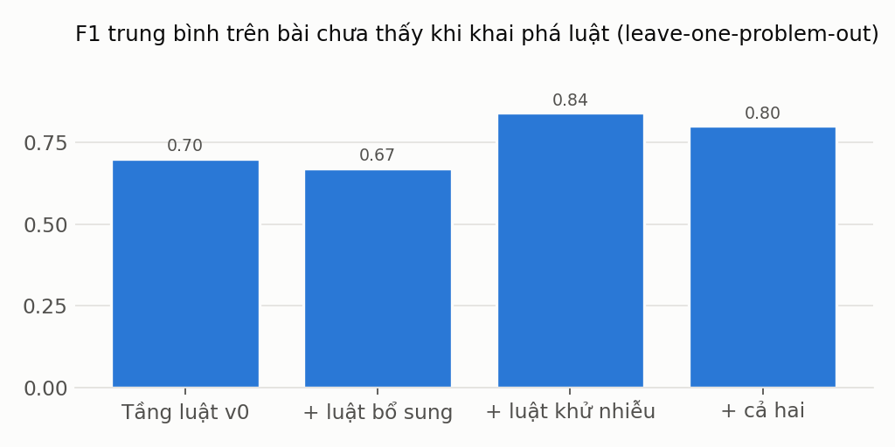
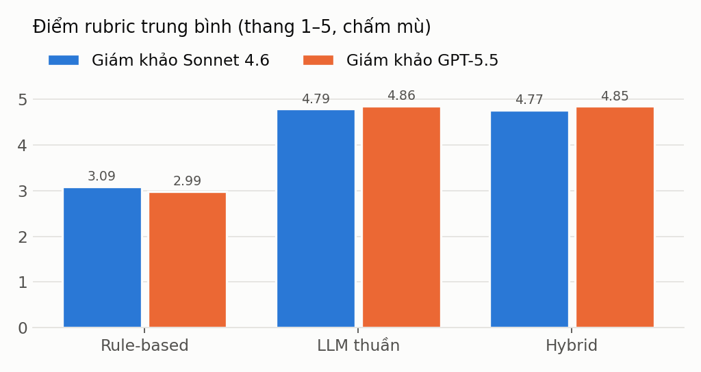
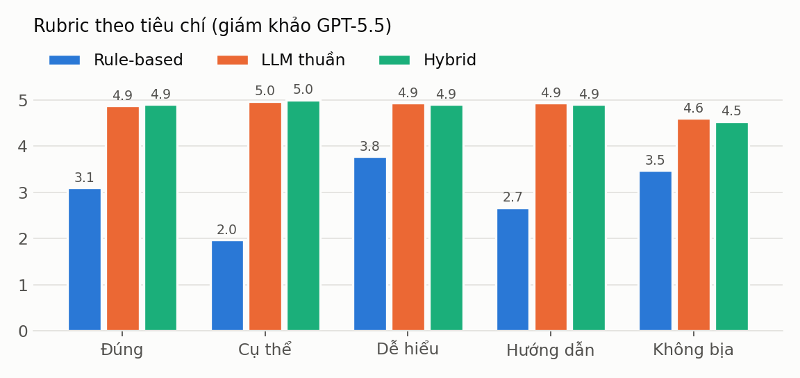
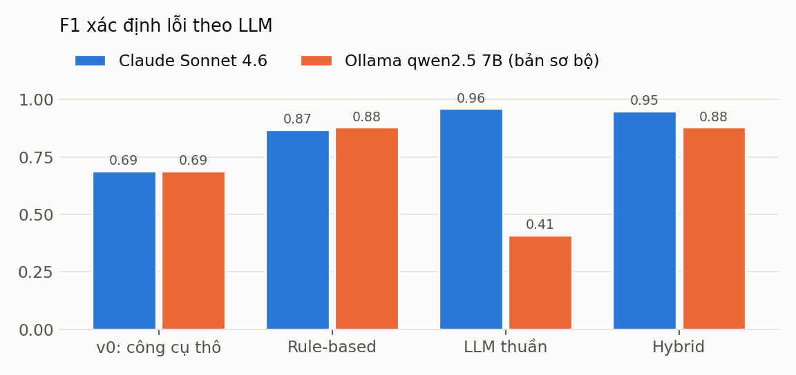

# Chương: Thực nghiệm và đánh giá (bản nháp)

> Bản nháp cho việc Tuần 4 #6. Số liệu lấy từ các báo cáo sinh tự động (`docs/eval_report.md`, `docs/rubric_report.md`, `docs/mining_report.md`, `docs/eval_report_so_bo_3bai.md`). Biểu đồ vẽ bằng `docs/img/eval/make_charts.py`. Mục "Người chấm" sẽ bổ sung khi nhóm chấm xong phiếu mù.

## 1. Câu hỏi đánh giá

1. Hệ v1 xác định lỗi tốt hơn hệ nền v0 đến mức nào?
2. Trong v1, ba cách chẩn đoán (Rule-based, LLM thuần, Hybrid) khác nhau thế nào về độ chính xác, độ tin cậy và chi phí?
3. Lời giải thích của mỗi cách có chất lượng ra sao đối với sinh viên?
4. Luật khai phá từ log có dùng được cho bài tập chưa thấy không?
5. Kết quả thay đổi thế nào khi đổi LLM mạnh trên cloud sang LLM nhỏ chạy local?

## 2. Dữ liệu

Không có log thật của sinh viên (việc dùng dataset ngoài đã cắt, xem `docs/error_stats.md`), nên nhóm tạo benchmark bằng cách cài lỗi có chủ đích vào lời giải mẫu của 10 bài tập. Bộ cài lỗi có 19 toán tử, mỗi toán tử ứng với một Bug Pattern: bỏ `&` trong scanf, đổi `<` thành `<=`, bỏ bước tăng vòng lặp, bỏ khởi tạo, free sớm, v.v. Mỗi bài lỗi mang 1–2 lỗi, sau khi loại các biến thể trùng mã nguồn. Kết quả là 270 bài có nhãn đúng: mã lỗi và dòng bị cài.

Do chi phí gọi LLM, phần so sánh các cách chẩn đoán dùng 30 bài, lấy mẫu đều theo bài tập (seed 0). Mỗi bài tập có 3–4 bài, riêng P005 chỉ có 1 bài vì bài tập này chỉ sinh được 1 biến thể hợp lệ. Trong 30 bài, 17 bài mang 2 lỗi.

## 3. Các cấu hình so sánh

| Cấu hình | Ai xác định lỗi | Ai giải thích |
|---|---|---|
| v0: công cụ thô | gcc, cppcheck, ASan/UBSan, luật tự viết | Câu gợi ý cố định theo mã lỗi |
| Rule-based | Như v0, thêm luật khử nhiễu khai phá từ log | Câu gợi ý cố định, thêm tri thức từ KG |
| LLM thuần | LLM, chỉ thấy đề bài, code và kết quả chấm | LLM |
| Hybrid | Lỗi do công cụ kiểm chứng (sau khử nhiễu), cộng lỗi LLM đề xuất khi bài chưa đạt test (chỉ giữ nếu mã có trong KG và chỉ đúng dòng có thật) | LLM, với dữ kiện từ KG trong prompt |

LLM chính là Claude Sonnet 4.6 (gọi qua Microsoft Foundry, effort medium, structured outputs). Bản sơ bộ dùng Ollama qwen2.5 7B chạy trên CPU.

## 4. Độ đo

- **Xác định lỗi:** precision, recall và F1 trên tập mã lỗi dự đoán so với nhãn, tính gộp trên cả 30 bài. Chỉ tính các mã mà bộ cài lỗi sinh được, vì các mã khác không có nhãn để so. Thêm hai độ đo phụ: tỉ lệ bài đúng hoàn toàn (tập mã trùng khớp nhãn) và tỉ lệ chỉ đúng dòng lỗi (lệch tối đa 1 dòng).
- **Độ tin cậy:** số mã lỗi LLM bịa ra bị chặn, tỉ lệ phải lùi về luật vì LLM lỗi, và tỉ lệ nghi lộ lời giải (lời giải thích chứa từ 3 dòng trông như code).
- **Chi phí:** thời gian chẩn đoán mỗi bài.
- **Chất lượng giải thích:** rubric 5 tiêu chí, thang 1–5: Đúng, Cụ thể, Dễ hiểu, Hướng dẫn (chỉ hướng sửa, không đưa sẵn lời giải), Không bịa. Hai giám khảo LLM khác hãng (Claude Sonnet 4.6 và GPT-5.5) chấm mù, không biết lời giải thích đến từ cấu hình nào. Nhóm chấm tay thêm 36 lời giải thích (12 bài, phiếu mù) để kiểm tra giám khảo LLM.
- **Gộp:** P/R/F1 tính trên tổng số mã đúng, thừa, thiếu của cả 30 bài (micro), không lấy trung bình từng bài.

## 5. Kết quả xác định lỗi

| Cấu hình | P | R | F1 | Đúng hoàn toàn | Dòng đúng | Thời gian (trung vị) |
|---|---|---|---|---|---|---|
| v0: công cụ thô | 0.60 | 0.81 | 0.69 | 37% | 53% | dưới 0,1 s |
| Rule-based | 0.97 | 0.79 | 0.87 | 63% | 53% | dưới 0,1 s |
| LLM thuần | 0.96 | 0.96 | **0.96** | 87% | **91%** | 9,7 s |
| Hybrid | 0.92 | **0.98** | 0.95 | 87% | 72% | 12,1 s |

Không mã lỗi nào do LLM bịa ra phải chặn, và không lượt nào phải lùi về luật vì LLM lỗi. Các cấu hình dùng công cụ còn báo thêm 5 mã nằm ngoài tập mã có nhãn (ví dụ biến khai báo mà không dùng); các mã này không tính vào P/R/F1 vì không có nhãn để so.

Nhận xét:

- **v0 → Rule-based:** precision tăng từ 0.60 lên 0.97. Công cụ chuẩn báo rất nhiều cảnh báo là hệ quả của một lỗi gốc khác (ví dụ thiếu `&` trong scanf khiến chương trình đọc biến chưa khởi tạo rồi crash, nên công cụ báo thêm lỗi biến chưa khởi tạo). Luật khử nhiễu bỏ đúng các cảnh báo này. Recall gần như giữ nguyên.
- **Rule-based → Hybrid:** recall tăng từ 0.79 lên 0.98 nhờ phần LLM đề xuất thêm. Rõ nhất ở lỗi lệch biên vòng lặp: OFF_BY_ONE (9 bài) có recall 44% với công cụ, lên 100% với Hybrid. INFINITE_LOOP tăng từ 70% lên 100%, FORMAT_MISMATCH từ 67% lên 100%. Precision giảm còn 0.92: LLM đề xuất sai 3 lỗi (MEM_LEAK, ARRAY_OOB, UNINIT_VAR); các lỗi sai còn lại là cảnh báo công cụ mà Rule-based cũng mắc.
- **Hybrid và LLM thuần:** gần ngang nhau về F1 (0.95 so với 0.96). LLM thuần chỉ đúng dòng lỗi tốt hơn (91% so với 72%), vì Hybrid giữ dòng do công cụ báo, mà công cụ thường báo ở dòng lỗi biểu hiện chứ không phải dòng gây lỗi (ví dụ bỏ `= 0` ở dòng khai báo nhưng gcc báo ở dòng cộng dồn).
- Hybrid chỉ còn yếu ở NULL_DEREF (1/2 bài), giống Rule-based.

## 6. Luật khai phá trên bài tập chưa thấy

Để kiểm tra luật khai phá có học thuộc dữ liệu không, nhóm đánh giá leave-one-problem-out: khai phá luật trên 9 bài tập, áp lên bài tập còn lại, lặp cho cả 10 bài tập. Chỉ dùng luật có confidence ≥ 0.8.

| Tầng luật | F1 trung bình trên bài chưa thấy |
|---|---|
| Tầng luật v0 | 0.70 |
| + luật bổ sung (đoán lỗi công cụ bỏ sót) | 0.67 |
| + luật khử nhiễu (bỏ cảnh báo hệ quả) | **0.84** |
| + cả hai | 0.80 |

Luật khử nhiễu tổng quát được sang bài mới, vì chúng mô tả quan hệ giữa các cảnh báo (lỗi gốc kéo theo cảnh báo hệ quả) chứ không gắn với một bài tập. Luật bổ sung làm giảm F1, vì với 10 bài tập chúng dễ học thuộc đặc điểm từng bài. Vì vậy v1 chỉ đưa luật khử nhiễu vào rule engine.

Lưu ý: kết quả mục 5 dùng luật khai phá trên toàn bộ 270 bài, gồm cả 30 bài đánh giá. Do đó số đo của Rule-based và Hybrid ở mục 5 hơi lạc quan; con số không bị ảnh hưởng là kết quả leave-one-problem-out ở mục này.

## 7. Chất lượng lời giải thích

| Cấu hình | Giám khảo Sonnet 4.6 | Giám khảo GPT-5.5 |
|---|---|---|
| Rule-based | 3.09 | 2.99 |
| LLM thuần | 4.79 | 4.86 |
| Hybrid | 4.77 | 4.85 |

So từng bài (hơn / hoà / kém):

| | Giám khảo Sonnet | Giám khảo GPT-5.5 |
|---|---|---|
| Hybrid so với Rule-based | 29 / 0 / 1 | 29 / 0 / 1 |
| Hybrid so với LLM thuần | 13 / 10 / 7 | 5 / 17 / 8 |

Nhận xét:

- Cả hai giám khảo đều chấm Hybrid hơn hẳn Rule-based (29/30 bài). Khoảng cách lớn nhất ở tiêu chí "Cụ thể" (khoảng 2 lên 5): câu gợi ý cố định không gắn với code của sinh viên.
- Hybrid và LLM thuần ngang nhau. Giám khảo Sonnet nghiêng nhẹ về Hybrid, giám khảo GPT-5.5 nghiêng nhẹ về LLM thuần; chênh lệch nằm trong mức dao động giữa hai giám khảo. Hybrid được điểm "Hướng dẫn" cao hơn với giám khảo Sonnet (4.67 so với 4.40).
- "Không bịa" là tiêu chí thấp nhất của cả hai cấu hình dùng LLM (4.53–4.77).

**Độ tin cậy của giám khảo.** Trên 330 lời giải thích cả hai cùng chấm, tương quan Pearson giữa hai giám khảo cao ở "Cụ thể" (0.92), khá ở "Dễ hiểu" (0.77) và "Hướng dẫn" (0.76), nhưng thấp ở "Đúng" (0.64) và "Không bịa" (0.47). Hai tiêu chí cần đối chiếu với code nhất cũng là hai tiêu chí giám khảo LLM ít đồng thuận nhất, nên phần chấm tay quan trọng nhất ở đây. Giám khảo Sonnet cùng model với bên sinh lời giải thích nên có thể ưu ái văn phong của chính nó; giám khảo GPT-5.5 dùng để đối chứng.

**Người chấm.** *(Bổ sung sau khi nhóm chấm phiếu mù `data/eval/human_rubric.csv`: độ khớp giữa người và từng giám khảo, theo từng tiêu chí.)*

## 8. Ảnh hưởng của LLM

Bản sơ bộ với Ollama qwen2.5 7B (30 bài trên 3 bài tập đầu, Hybrid bản đầu chưa cho LLM đề xuất thêm lỗi):

| Cấu hình | F1 với Sonnet 4.6 | F1 với qwen2.5 7B | Thời gian trung vị với qwen2.5 7B |
|---|---|---|---|
| Rule-based | 0.87 | 0.88 | dưới 0,1 s |
| LLM thuần | 0.96 | 0.41 | 156,5 s |
| Hybrid | 0.95 | 0.88 | 121,1 s |

Hai lần chạy khác tập bài và khác phiên bản Hybrid, nên chỉ so được xu hướng: với LLM nhỏ, LLM thuần gần như không dùng được (F1 0.41, mỗi bài khoảng 2,5 phút trên CPU), còn Hybrid giữ được độ chính xác của phần luật. Với LLM mạnh, LLM thuần tự xác định lỗi tốt và phần luật chủ yếu đóng vai trò kiểm chứng, truy vết và dự phòng. Hybrid bản hiện tại chưa được chạy lại với Ollama.

## 9. Thảo luận

- **Mỗi thành phần đóng góp một phần khác nhau.** Luật khử nhiễu khai phá từ log nâng precision; LLM nâng recall và chất lượng giải thích; KG cung cấp tri thức để giải thích và chọn hành động sư phạm.
- **Hybrid không thắng LLM thuần về số đo khi LLM đủ mạnh.** Giá trị của Hybrid nằm ở chỗ khác: mỗi lỗi có nguồn rõ ràng (công cụ kiểm chứng hay LLM đề xuất, giao diện hiển thị khác nhau); mã lỗi luôn nằm trong danh mục nên nối được vào KG và lộ trình học; hệ vẫn chạy khi không có LLM hoặc LLM yếu.
- **Chi phí:** Hybrid chậm hơn Rule-based khoảng 12 giây mỗi lần chẩn đoán. Kết quả được lưu theo bài nộp nên xem lại không tốn thêm.

## 10. Hạn chế

- Lỗi do máy cài vào lời giải mẫu ngắn, chưa phải bài làm thật của sinh viên. Phân bố lỗi do thiết kế bộ cài lỗi mà ra (`docs/error_stats.md`). Benchmark thiếu lỗi sai kiểu, chia cho 0, thiếu return, và có rất ít lỗi cú pháp.
- Đánh giá so sánh chỉ trên 30 bài, nên chênh lệch nhỏ (ví dụ F1 0.95 so với 0.96) không có ý nghĩa thống kê.
- Luật khai phá học trên cùng tập dữ liệu dùng để đánh giá ở mục 5 (xem lưu ý cuối mục 6).
- Giám khảo LLM đồng thuận thấp ở tiêu chí "Không bịa"; kết luận về tiêu chí này chờ kết quả chấm tay.
- "Nghi lộ lời giải" chỉ là kiểm tra tự động thô.
