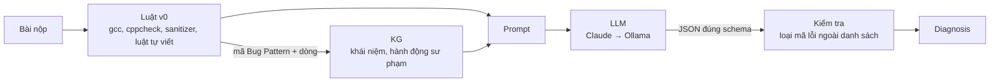

# Diagnosis Agent và lớp trung gian LLM

Code: `backend/app/agents/diagnosis.py`, `backend/app/llm/`.

## Luồng hybrid



- **Luật là nguồn sự thật**: LLM chỉ được giải thích các mã lỗi luật đã phát hiện. JSON schema giới
  hạn `bug_pattern` trong đúng danh sách đó, và code lọc lại một lần nữa phòng khi model local không
  tuân thủ schema. Mã bị loại được ghi vào `rejected`, dùng để đo tỉ lệ bịa ở tuần 4.
- **KG cung cấp tri thức**: tên khái niệm, gợi ý chuẩn và hành động sư phạm (ưu tiên theo phong cách
  học) được đưa vào prompt, rồi trả về cho sinh viên dưới dạng `actions` để học thêm.
- **Không viết hộ lời giải**: prompt yêu cầu chỉ gợi ý hướng sửa.
- **Không bao giờ lỗi trắng**: LLM lỗi hoặc chưa cấu hình thì tự lùi về giải thích bằng luật; KG tắt thì
  dùng danh mục `bug_patterns.yaml`. Lý do ghi trong `notes`.

## Ba chế độ (cũng là ba cấu hình so sánh ở tuần 4)

| `mode` | Ai tìm lỗi | Ai giải thích | Gọi LLM |
|---|---|---|---|
| `rule` | Luật | Gợi ý cố định + KG | Không |
| `llm_only` | LLM (chỉ thấy đề, code, kết quả chấm) | LLM | Có |
| `hybrid` | Luật | LLM, có KG làm ngữ cảnh | Có |

## Lớp trung gian LLM

Agent chỉ gọi `FallbackLLM.generate(system, user, schema)`. Thứ tự provider đặt bằng
`LLM_PROVIDERS` (mặc định `claude,ollama`):

- `claude`: Anthropic SDK, model `CLAUDE_MODEL` (mặc định `claude-opus-5-5`), structured outputs.
  Bật fallback phía server: nếu model từ chối vì bộ lọc an toàn, API tự chạy lại trên model dự phòng.
- `ollama`: model local `OLLAMA_MODEL` (mặc định `qwen2.5:7b-instruct`), dùng khi demo không có
  mạng: `docker compose --profile ollama up -d` rồi
  `docker compose exec ollama ollama pull qwen2.5:7b-instruct`.

Thêm provider mới: viết class có `name` và `generate_json(system, user, schema) -> dict`, ném
`LLMError` khi thất bại, rồi đăng ký trong `backend/app/llm/__init__.py`.

## API

```
POST /submissions/{id}/diagnosis?mode=hybrid&styles=visual[&refresh=true]
```

Kết quả được lưu trong bảng `diagnoses` (SQLite) theo (bài nộp, chế độ, phong cách học), nên gọi lại
không tốn phí LLM. Kết quả đã phải lùi về luật thì không lưu, để lần sau thử LLM lại.

## Cá nhân hoá theo phong cách học

Phong cách học hiệu lực (`backend/app/student/learning_style.py`) kết hợp bảng hỏi 6 câu với hành
vi tương tác:
- mở hành động sư phạm loại nào (theo `styles` của hành động trong KG);
- có mở KG viewer không;
- sau khi nộp sai thì nộp lại ngay hay xem chẩn đoán, hỏi trợ lý trước.

Hành vi càng nhiều càng nặng, tối đa gấp đôi bảng hỏi. Tab Hồ sơ năng lực hiện điểm từng chiều
kèm bằng chứng.

Phong cách hiệu lực được dùng ở ba chỗ:
- **Diagnosis Agent (hybrid):** thêm hướng dẫn trình bày vào prompt. Hình ảnh: sơ đồ ô nhớ hoặc
  bảng giá trị. Lời giải thích: giải thích tuần tự. Thực hành: một thử nghiệm cụ thể để tự kiểm
  chứng. Suy ngẫm: câu hỏi gợi mở.
- **Learning-Path Agent:** ưu tiên hành động sư phạm khớp phong cách.
- **Chat Agent:** chọn hành động minh hoạ khi giải thích khái niệm.

## Đánh giá 3 cấu hình (tuần 3–4)

```bash
LLM_PROVIDERS= python -m backend.app.evaluation.compare --configs v0,rule   # không cần LLM, vài giây
LLM_PROVIDERS=ollama python -m backend.app.evaluation.compare --limit 30    # Ollama CPU: ~2-3 phút/lượt
LLM_PROVIDERS=claude python -m backend.app.evaluation.compare               # đủ 136 bài, cần API key
```

- **Đầu vào:** `data/mined/mutants.jsonl`, 136 bài có nhãn đúng, đã gồm báo cáo chấm đầy đủ. Mọi cấu hình nhận cùng đề bài, code và kết quả chấm.
- **Chạy tiếp được:** kết quả ghi dần vào `data/eval/results.jsonl`. Dừng giữa chừng rồi chạy lại thì chỉ chạy các lượt (bài, cấu hình, LLM) còn thiếu.
- **Báo cáo** `docs/eval_report.md` gồm:
  - P/R/F1 xác định lỗi, tỉ lệ đúng hoàn toàn, chỉ đúng dòng;
  - số mã LLM bịa bị chặn, tỉ lệ lùi về luật, nghi lộ lời giải, thời gian;
  - recall theo từng loại lỗi.
- **Chưa tự động hoá:** chất lượng lời giải thích (đúng, dễ hiểu, không lộ lời giải). Phần này cần chấm theo rubric ở tuần 4: LLM-as-judge kết hợp người chấm. Trường `explanations` trong `results.jsonl` đã lưu sẵn lời giải thích của từng cấu hình để chấm.
