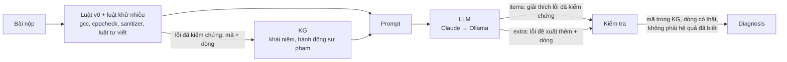

# Diagnosis Agent và lớp trung gian LLM

Code: `backend/app/agents/diagnosis.py`, `backend/app/llm/`.

## Luồng hybrid



- **Lỗi đã kiểm chứng**: lỗi công cụ tìm thấy (sau khi luật khai phá bỏ cảnh báo chỉ là hệ quả).
  LLM phải giải thích đúng các mã này; JSON schema giới hạn `bug_pattern` của `items` trong đúng
  danh sách đó.
- **Lỗi LLM đề xuất thêm** (chỉ khi bài chưa đạt test): công cụ không bắt được lỗi logic như sai
  biên vòng lặp, sai công thức. LLM ghi các lỗi này vào `extra`, và mỗi lỗi chỉ được giữ khi:
  mã nằm trong danh mục của KG; chỉ đúng một dòng có thật trong bài; không phải mã mà luật khai
  phá vừa xác định là hệ quả của lỗi khác. Lỗi được giữ mang `source="llm"`, `confidence=0.5` và
  ghi chú "công cụ chưa kiểm chứng", nên giao diện phân biệt được với lỗi đã kiểm chứng.
- **Mã sai bị loại** (bịa mã, thiếu dòng, dòng không tồn tại) được ghi vào `rejected`; code lọc lại
  cả khi model local không tuân thủ schema. Bài đạt test và công cụ không báo gì thì không gọi LLM.
- **KG cung cấp tri thức**: tên khái niệm, gợi ý chuẩn và hành động sư phạm (ưu tiên theo phong cách
  học) được đưa vào prompt, rồi trả về cho sinh viên dưới dạng `actions` để học thêm.
- **Không viết hộ lời giải**: prompt yêu cầu chỉ gợi ý hướng sửa.
- **Không bao giờ lỗi trắng**: LLM lỗi hoặc chưa cấu hình thì tự lùi về giải thích bằng luật; KG tắt thì
  dùng danh mục `bug_patterns.yaml`. Lý do ghi trong `notes`.

## Ba chế độ (cũng là ba cấu hình so sánh ở tuần 4)

| `mode` | Ai tìm lỗi | Ai giải thích | Gọi LLM |
|---|---|---|---|
| `rule` | Luật | Gợi ý cố định + KG | Không |
| `llm_only` | LLM (chỉ thấy đề, code, kết quả chấm) | LLM | Có |
| `hybrid` | Luật (đã kiểm chứng) + LLM đề xuất thêm (qua kiểm tra) | LLM, có KG làm ngữ cảnh | Có |

## Lớp trung gian LLM

Agent chỉ gọi `FallbackLLM.generate(system, user, schema)`. Thứ tự provider đặt bằng
`LLM_PROVIDERS` (mặc định `claude,ollama`):

- `claude`: Anthropic SDK, model `CLAUDE_MODEL` (mặc định `claude-opus-5-5`), structured outputs.
  Bật fallback phía server: nếu model từ chối vì bộ lọc an toàn, API tự chạy lại trên model dự phòng.
- `azure`: GPT/DeepSeek triển khai trên Azure (`AZURE_OPENAI_DEPLOYMENT`, mặc định `gpt-5.5`),
  dùng chung resource và key với Claude trên Foundry. Dùng làm giám khảo thứ hai khi chấm rubric.
- Claude qua Microsoft Foundry (Azure): đặt `ANTHROPIC_FOUNDRY_RESOURCE` và
  `ANTHROPIC_FOUNDRY_API_KEY`; `CLAUDE_MODEL` là tên deployment.
- `ollama`: model local `OLLAMA_MODEL` (mặc định `qwen2.5:7b-instruct`), dùng khi demo không có
  mạng: `docker compose --profile ollama up -d` rồi
  `docker compose exec ollama ollama pull qwen2.5:7b-instruct`.

Thêm provider mới: viết class có `name` và `generate_json(system, user, schema) -> dict`, ném
`LLMError` khi thất bại, rồi đăng ký trong `backend/app/llm/__init__.py`.

## API

```
POST /submissions/{id}/diagnosis?mode=hybrid&styles=visual[&refresh=true]
```

Kết quả được lưu trong bảng `diagnoses` (SQLite) theo (bài nộp, chế độ, phong cách học), nên gọi lại
không tốn phí LLM. Kết quả đã phải lùi về luật thì không lưu, để lần sau thử LLM lại.

## Cá nhân hoá theo phong cách học

Phong cách học hiệu lực (`backend/app/student/learning_style.py`) kết hợp bảng hỏi 6 câu với hành
vi tương tác:
- mở hành động sư phạm loại nào (theo `styles` của hành động trong KG);
- có mở KG viewer không;
- sau khi nộp sai thì nộp lại ngay hay xem chẩn đoán, hỏi trợ lý trước.

Hành vi càng nhiều càng nặng, tối đa gấp đôi bảng hỏi. Tab Hồ sơ năng lực hiện điểm từng chiều
kèm bằng chứng.

Phong cách hiệu lực được dùng ở ba chỗ:
- **Diagnosis Agent (hybrid):** thêm hướng dẫn trình bày vào prompt. Hình ảnh: sơ đồ ô nhớ hoặc
  bảng giá trị. Lời giải thích: giải thích tuần tự. Thực hành: một thử nghiệm cụ thể để tự kiểm
  chứng. Suy ngẫm: câu hỏi gợi mở.
- **Learning-Path Agent:** ưu tiên hành động sư phạm khớp phong cách.
- **Chat Agent:** chọn hành động minh hoạ khi giải thích khái niệm.

## Đánh giá 3 cấu hình (tuần 3–4)

```bash
LLM_PROVIDERS= python -m backend.app.evaluation.compare --configs v0,rule   # không cần LLM, vài giây
LLM_PROVIDERS=ollama python -m backend.app.evaluation.compare --limit 30    # Ollama CPU: ~2-3 phút/lượt
LLM_PROVIDERS=claude python -m backend.app.evaluation.compare               # đủ 270 bài, cần API key
```

- **Đầu vào:** `data/mined/mutants.jsonl`, 270 bài có nhãn đúng từ 10 bài tập (đã loại biến thể trùng mã nguồn), đã gồm báo cáo chấm đầy đủ. Mọi cấu hình nhận cùng đề bài, code và kết quả chấm.
- **Chạy tiếp được:** kết quả ghi dần vào `data/eval/results.jsonl`. Dừng giữa chừng rồi chạy lại thì chỉ chạy các lượt (bài, cấu hình, LLM) còn thiếu.
- **Báo cáo** `docs/eval_report.md` gồm:
  - P/R/F1 xác định lỗi, tỉ lệ đúng hoàn toàn, chỉ đúng dòng;
  - số mã LLM bịa bị chặn, tỉ lệ lùi về luật, nghi lộ lời giải, thời gian;
  - recall theo từng loại lỗi.

## Chấm lời giải thích theo rubric

Bảng P/R/F1 chỉ đo việc xác định lỗi. Chất lượng lời giải thích được chấm bằng
`backend/app/evaluation/rubric.py`, dựa trên lời giải thích đã lưu trong `results.jsonl` nên
không cần chạy lại chẩn đoán.

```bash
LLM_PROVIDERS=claude python -m backend.app.evaluation.rubric       # LLM-as-judge
python -m backend.app.evaluation.rubric --export-human 12          # phiếu chấm cho người
python -m backend.app.evaluation.rubric --report-only              # gộp điểm người + LLM
```

- **5 tiêu chí, thang 1–5:**
  - Đúng: đúng bản chất lỗi thật;
  - Cụ thể: chỉ ra dòng, biến của chính code này;
  - Dễ hiểu: hợp với sinh viên năm nhất;
  - Hướng dẫn: cho bước sửa nhưng không đưa sẵn lời giải;
  - Không bịa: không nêu lỗi không có.
- **Giám khảo được biết lỗi thật đã cài** (đáp án), nhưng **không biết** lời giải thích đến từ cấu hình nào.
- **Người chấm** nhận `data/eval/human_rubric.csv`: 3 cấu hình của mỗi bài trộn lẫn, đánh mã `H001`... Khoá giải mã nằm riêng trong `human_key.json`, người chấm không mở file này. Điền điểm, lưu lại CSV, rồi chạy `--report-only`.
- **Báo cáo** `docs/rubric_report.md` gồm:
  - điểm trung bình từng tiêu chí;
  - số bài Hybrid hơn / hoà / kém từng cấu hình còn lại;
  - độ khớp giữa LLM và người (tương quan Pearson, độ lệch trung bình).
- **Nên dùng giám khảo khác model sinh lời giải thích** (ví dụ Claude chấm lời giải thích của Ollama), vì LLM có xu hướng ưu ái văn phong của chính mình. Đối chiếu với người chấm là cách kiểm tra lại.
