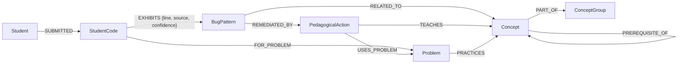

# Lược đồ Knowledge Graph

Nguồn tri thức nằm trong `knowledge/*.yaml` (sửa ở đó, không sửa trực tiếp trên Neo4j).
Code: `backend/app/kg/` (`model.py` đọc và kiểm tra, `loader.py` nạp, `queries.py` truy vấn).



Chuỗi bắt buộc theo đề bài:
`[Student_Code] -(Exhibits)-> [Bug_Pattern] -(Remediated_By)-> [Pedagogical_Action]`.

## Node

| Nhãn | Nguồn | Thuộc tính chính |
|---|---|---|
| `ConceptGroup` | `concepts.yaml` | `id`, `name`: 5 cụm (Nền tảng, Biến, Con trỏ, CTDL, Quản lý bộ nhớ) |
| `Concept` | `concepts.yaml` | `id`, `name`, `level` (1–3), `depth` (độ dài chuỗi tiên quyết), `description` |
| `BugPattern` | `bug_patterns.yaml` | `id` (mã lỗi), `name`, `hint`, `detected_by` |
| `PedagogicalAction` | `pedagogical_actions.yaml` | `id`, `type`, `title`, `content`, `styles`, `level` |
| `Problem` | `data/problems/*/problem.yaml` | `id`, `title` |
| `Student` | log SQLite của v0 | `id` |
| `StudentCode` | log SQLite của v0 | `id` (mã lần nộp), `verdict`, `score`, `language`, `created_at` |

`PedagogicalAction.type`: `GIAI_THICH`, `VI_DU`, `TRUC_QUAN`, `GO_LOI`, `BAI_TAP`, `CAU_HOI`.
`PedagogicalAction.styles` (Felder–Silverman rút gọn): `visual` / `verbal`, `active` / `reflective`.

## Lệnh

```bash
python -m backend.app.kg.load --check   # kiểm tra YAML (không cần Neo4j): tham chiếu sai, chu trình...
docker compose up -d neo4j               # Neo4j Browser: http://localhost:7474
python -m backend.app.kg.load            # nạp phần tĩnh + log nộp bài (chạy lại nhiều lần được)
python -m backend.app.kg.load --reset    # xoá đồ thị rồi nạp lại
```

## Truy vấn cho agent (`KGQueries`) và API

| Hàm | API | Dùng bởi |
|---|---|---|
| `concepts_for_bugs(codes)` | | Diagnosis Agent: khái niệm cần giải thích |
| `remediation(code, styles)` | `GET /kg/bugs/{code}/remediation?styles=visual` | Diagnosis / Learning-Path Agent |
| `student_weak_concepts(sid)` | `GET /kg/students/{sid}/weak-concepts` | Hồ sơ năng lực (E) |
| `learning_path(sid, bugs, styles)` | `GET /kg/students/{sid}/learning-path?bugs=MEM_LEAK&styles=visual` | Learning-Path Agent |
| `graph(include_students)` | `GET /kg/graph` | KG viewer (E) |
| `node(id)` | `GET /kg/nodes/{id}` | KG viewer: bảng chi tiết |

**Lộ trình học** (`learning_path`): khái niệm gắn với lỗi hiện tại, cộng với các khái niệm
tiên quyết mà sinh viên từng mắc lỗi liên quan. Các bước sắp theo `depth` (khái niệm nền trước).
Mỗi khái niệm chọn một hành động theo thứ tự ưu tiên: sửa đúng lỗi hiện tại, khớp phong cách học, dễ hơn.

## KG viewer

Trang `http://localhost:8000/kg-viewer` (Cytoscape.js) cần Neo4j đang chạy và đã nạp đồ thị:

- màu và hình theo loại node; bấm vào mục trong chú thích để ẩn hoặc hiện từng loại;
- bấm vào node để xem thuộc tính và các node kề, rồi bấm tiếp node kề để đi theo quan hệ;
- tick **Hiện sinh viên** rồi chọn một sinh viên: đồ thị làm nổi chuỗi
  Sinh viên → Bài nộp → Mẫu lỗi → Khái niệm/Hành động, viền đỏ các khái niệm yếu;
- mở thẳng một trạng thái bằng đường dẫn, tiện cho demo:
  `/kg-viewer#student=sv01`, `/kg-viewer#node=MEM_LEAK`, hoặc ghép cả hai bằng `&`.

## Truy vấn mẫu trong Neo4j Browser

```cypher
// Toàn bộ concept map
MATCH (c:Concept)-[r:PREREQUISITE_OF|PART_OF]->(x) RETURN c, r, x

// Lỗi rò rỉ bộ nhớ: khái niệm liên quan và cách khắc phục
MATCH (b:BugPattern {id: 'MEM_LEAK'})-[r]->(x) RETURN b, r, x

// Chuỗi theo đề bài cho một sinh viên
MATCH p = (:Student {id: 'sv1'})-[:SUBMITTED]->(:StudentCode)-[:EXHIBITS]->(:BugPattern)
          -[:REMEDIATED_BY]->(:PedagogicalAction)
RETURN p
```
