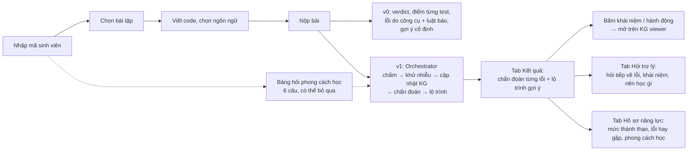
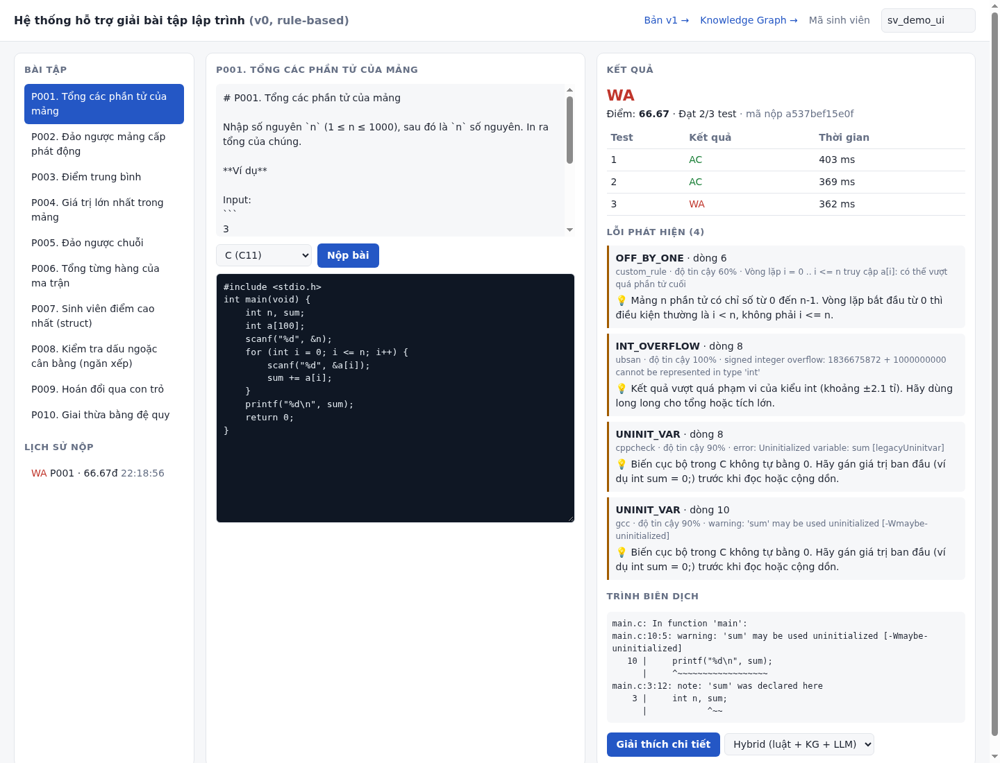
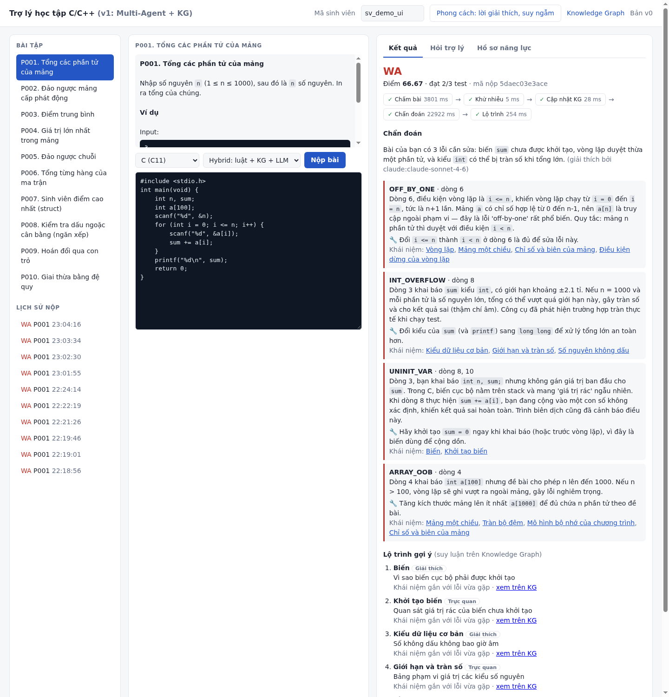
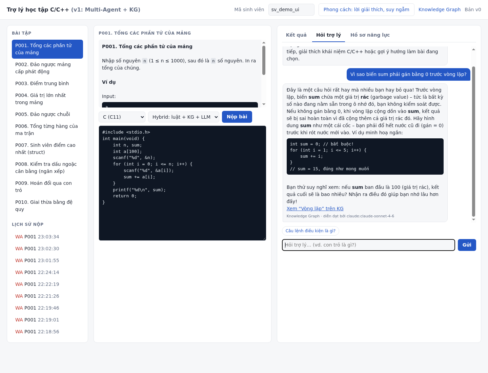
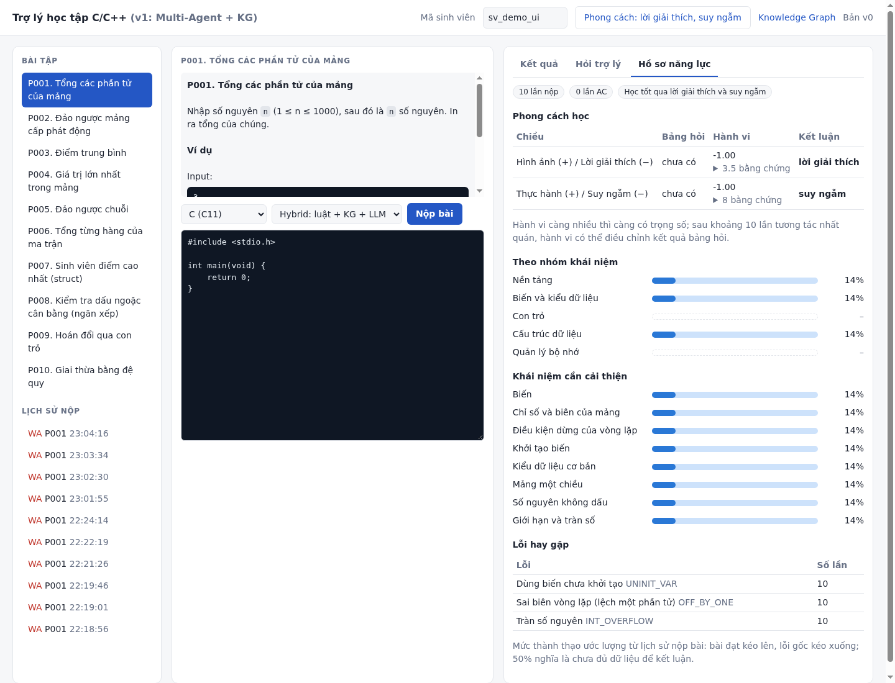
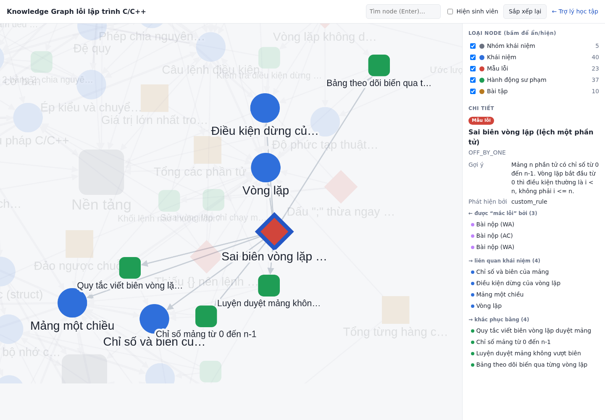

# Thiết kế giao diện v0 và v1

Tài liệu cho việc Tuần 1 #15 (wireframe UI tổng thể). Giao diện đã được code trước khi có tài liệu này, nên phần khung màn hình dưới đây mô tả lại bố cục đang chạy, kèm ảnh chụp thật để dùng cho báo cáo và slide so sánh v0/v1.

| Giao diện | Đường dẫn | Mã nguồn | Dành cho |
|---|---|---|---|
| v0: hệ nền | `/v0` | [frontend/v0/index.html](../frontend/v0/index.html) | Nộp bài, xem kết quả chấm và lỗi do luật báo |
| v1: trợ lý học tập | `/` | [frontend/tutor/index.html](../frontend/tutor/index.html) | Như v0, cộng chẩn đoán đa agent, lộ trình học, chat, hồ sơ năng lực |
| Knowledge Graph | `/kg-viewer` | [frontend/kg/index.html](../frontend/kg/index.html) | Xem chuỗi khái niệm → mẫu lỗi → hành động sư phạm, và sinh viên trên KG |

Ba trang là HTML tĩnh, không cần build, gọi thẳng API FastAPI cùng cổng.

## Luồng thao tác



## v0: hệ nền

```
┌───────────────────────────────────────────────────────────────────────────────┐
│ Hệ thống hỗ trợ giải bài tập lập trình (v0)   Bản v1 → · KG →  [Mã sinh viên] │
├──────────────────┬───────────────────────────────┬────────────────────────────┤
│ BÀI TẬP          │ P001. Tên bài                 │ KẾT QUẢ                    │
│ ▣ P001 ...       │ ┌───────────────────────────┐ │ WA  Điểm 66.67 · 2/3 test  │
│ □ P002 ...       │ │ Đề bài (cuộn)             │ │ ┌──────┬────────┬───────┐ │
│ □ ...            │ └───────────────────────────┘ │ │ Test │ Kết quả│ Th.gian│ │
│                  │ [C (C11) ▾]  [Nộp bài]        │ └──────┴────────┴───────┘ │
│ LỊCH SỬ NỘP      │ ┌───────────────────────────┐ │ LỖI PHÁT HIỆN (n)          │
│ WA P001 22:18    │ │ Ô nhập code               │ │ ┃ MÃ_LỖI · dòng k          │
│ ...              │ │                           │ │ ┃ nguồn · độ tin cậy       │
│                  │ └───────────────────────────┘ │ ┃ 💡 gợi ý cố định          │
│                  │                               │ TRÌNH BIÊN DỊCH (log gcc)  │
└──────────────────┴───────────────────────────────┴────────────────────────────┘
```



Mỗi lỗi hiện mã Bug Pattern, dòng, công cụ phát hiện (gcc, cppcheck, ASan/UBSan, luật tự viết) và một câu gợi ý cố định lấy từ `knowledge/bug_patterns.yaml`. Nút "Giải thích chi tiết" ở cuối cột kết quả được thêm sau tag `v0` (khi có Diagnosis Agent), để so sánh nhanh ba chế độ chẩn đoán ngay trên trang v0.

## v1: trợ lý học tập

Giữ nguyên hai cột trái và giữa của v0, để sinh viên không phải học lại cách dùng. Thanh trên cùng thêm nút bảng hỏi phong cách học và liên kết tới KG. Cạnh nút nộp có thêm ô chọn chế độ chẩn đoán (Hybrid, chỉ luật + KG, chỉ LLM). Cột phải chuyển thành ba tab.

```
┌───────────────────────────────────────────────────────────────────────────────┐
│ Trợ lý học tập C/C++ (v1)  [Mã SV] [Phong cách: ...] Knowledge Graph · Bản v0 │
├──────────────────┬───────────────────────────────┬────────────────────────────┤
│ BÀI TẬP          │ P001. Tên bài                 │ [Kết quả][Hỏi trợ lý][Hồ sơ]│
│ ...              │ Đề bài                        │ WA  Điểm · mã nộp          │
│                  │ [C ▾] [Hybrid ▾] [Nộp bài]    │ ✓Chấm → ✓Khử nhiễu → ✓KG   │
│ LỊCH SỬ NỘP      │ Ô nhập code                   │ → ✓Chẩn đoán → ✓Lộ trình   │
│ ...              │                               │ Chẩn đoán: tóm tắt         │
│                  │                               │ ┃ MÃ_LỖI · dòng            │
│                  │                               │ ┃ giải thích theo code     │
│                  │                               │ ┃ 🔧 hướng sửa             │
│                  │                               │ ┃ Khái niệm: link KG       │
│                  │                               │ Lộ trình gợi ý             │
│                  │                               │ 1. Khái niệm [loại] tên    │
│                  │                               │    hành động · xem trên KG │
└──────────────────┴───────────────────────────────┴────────────────────────────┘
```

### Tab Kết quả



- Dải bước của Orchestrator (chấm bài → khử nhiễu → cập nhật KG → chẩn đoán → lộ trình) kèm thời gian từng bước, cho thấy luồng đa agent.
- Mỗi lỗi có lời giải thích bám vào dòng code của sinh viên, hướng sửa, và các khái niệm liên quan lấy từ KG (bấm để mở trên KG viewer).
- Lộ trình gợi ý do Learning-Path Agent suy ra trên KG (lỗi → khái niệm → hành động sư phạm), sắp theo khái niệm tiên quyết và phong cách học.

### Tab Hỏi trợ lý



Chat Agent định tuyến câu hỏi bằng luật (giải thích lỗi vừa nộp, khái niệm, nên học gì tiếp, gợi ý hướng làm bài, hỏi về năng lực) rồi gọi agent tương ứng. Câu trả lời ghi rõ nguồn (agent nào, LLM nào diễn đạt) và kèm liên kết tới KG. Các nút gợi ý dưới khung chat đổi theo ngữ cảnh.

### Tab Hồ sơ năng lực



Phong cách học (bảng hỏi và hành vi, kèm bằng chứng), mức thành thạo theo nhóm khái niệm, các khái niệm cần cải thiện và lỗi hay gặp. Dùng thanh đo thay cho radar chart vì dễ đọc hơn khi có nhiều khái niệm.

## Knowledge Graph viewer

```
┌───────────────────────────────────────────────────────────────────────────────┐
│ Knowledge Graph lỗi lập trình C/C++  [Tìm node] □Hiện SV [Sắp xếp lại] ← Trợ lý│
├────────────────────────────────────────────────────────────┬──────────────────┤
│                                                            │ LOẠI NODE        │
│          đồ thị Cytoscape                                  │ ☑ Nhóm  ☑ KN     │
│   (node đang chọn và lân cận nổi bật,                      │ ☑ Lỗi   ☑ HĐ     │
│    phần còn lại mờ đi)                                     │ ☑ Bài tập        │
│                                                            │ CHI TIẾT         │
│                                                            │ tên, mã, gợi ý,  │
│                                                            │ quan hệ vào/ra   │
└────────────────────────────────────────────────────────────┴──────────────────┘
```



Mở được thẳng một node qua `/kg-viewer#node=<id>`. Đây là cách các liên kết "xem trên KG" ở v1 hoạt động.

## So sánh giao diện v0 và v1

| | v0 | v1 |
|---|---|---|
| Kết quả chấm | Verdict, điểm, bảng test | Như v0 |
| Báo lỗi | Mã lỗi, dòng, công cụ, gợi ý cố định theo mã | Giải thích theo đúng code của sinh viên, hướng sửa, khái niệm liên quan |
| Nguồn tri thức | Bảng gợi ý trong YAML | Knowledge Graph, có liên kết mở từng node |
| Sau khi sửa lỗi | Không có | Lộ trình học: khái niệm cần ôn, hành động sư phạm, bài luyện |
| Hỏi thêm | Không có | Chat với trợ lý |
| Cá nhân hoá | Không có | Hồ sơ năng lực, phong cách học (bảng hỏi + hành vi) |
| Minh bạch | Ghi công cụ phát hiện lỗi | Thêm dải bước agent và thời gian, ghi rõ agent và LLM tạo ra từng câu trả lời |

## Ghi chú về ảnh chụp

- Chụp ngày 22/11/2026, LLM là Claude Sonnet 4.6, cùng một bài nộp cho P001 có ba lỗi cài sẵn: `sum` chưa khởi tạo, vòng lặp `i <= n`, và mảng `a[100]` nhỏ hơn giới hạn đề bài.
- v0 đạt 2/3 test còn v1 đạt 1/3 vì `sum` chưa khởi tạo mang giá trị rác khác nhau giữa các lần chạy, không phải do hai bản chấm khác nhau.
- Chụp lại: script trong phiên làm việc chèn đoạn JavaScript tự nộp bài vào bản sao của trang rồi chụp bằng Chrome headless (`--virtual-time-budget`). Có thể chụp tay theo đúng luồng trên.
